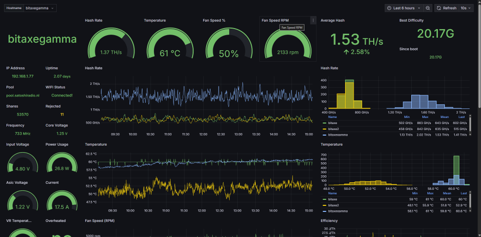

<p align="center">
  
</p>

# AxeOS Monitor on StartOS

> Everything not listed in this document should behave the same as upstream
> Grafana, Prometheus and JSON Exporter. If a feature, setting, or behavior is
> not mentioned here, the upstream documentation is accurate and fully
> applicable — see the Documentation section of `instructions.md` for links.

AxeOS Monitor scrapes the HTTP API of every [AxeOS](https://github.com/bitaxeorg/ESP-Miner) (ESP-Miner) Bitaxe miner on the local network, stores the samples in Prometheus, and charts them in a preconfigured Grafana dashboard. It is not a wrapper around a single upstream project: it composes three upstream images with package-supplied configuration.

- **Upstream repo (the monitored firmware):** <https://github.com/bitaxeorg/ESP-Miner>
- **Wrapper repo:** <https://github.com/Start9-Community/axeos-monitor-aio-startos>

<p align="center">
  
</p>

---

## Table of Contents

- [Image and Container Runtime](#image-and-container-runtime)
- [Volume and Data Layout](#volume-and-data-layout)
- [File Models](#file-models)
- [Dependencies](#dependencies)
- [Network Access and Interfaces](#network-access-and-interfaces)
- [Installation and First-Run Flow](#installation-and-first-run-flow)
- [Actions](#actions)
- [Tasks](#tasks)
- [Health Checks](#health-checks)
- [Backups and Restore](#backups-and-restore)
- [Limitations and Differences](#limitations-and-differences)
- [Quick Reference for AI Consumers](#quick-reference-for-ai-consumers)

---

## Image and Container Runtime

Three unmodified upstream images run side by side, each in its own subcontainer, each on its image's own entrypoint. Grafana's upstream image includes the updated CA store, and Start SDK 3.1.1 creates the `/proc` mount point when an image lacks it, so no custom Dockerfiles are needed.

| Subcontainer    | Image                               | Purpose                                             |
| --------------- | ----------------------------------- | --------------------------------------------------- |
| `grafana`       | `grafana/grafana`                    | The dashboard the user opens                        |
| `prometheus`    | `prom/prometheus`                    | Scrapes and stores the time series                  |
| `json-exporter` | `prometheuscommunity/json-exporter` | Turns a miner's JSON status into Prometheus metrics |

All three are built for x86_64 and aarch64; on a platform without a native build, StartOS runs an available image under emulation (`emulateMissing` is left at its default).

Two oneshots run before the daemons and are the only things the package executes itself:

| Oneshot            | Subcontainer | What it does                                                                                                              |
| ------------------ | ------------ | ------------------------------------------------------------------------------------------------------------------------- |
| `grafana-setup`    | `grafana`    | Copies provisioning and the selected dashboard out of the packaged assets, then chowns Grafana's paths to the image's uid |
| `prometheus-setup` | `prometheus` | Chowns the TSDB and config directories to the image's uid                                                                 |

Both run on every start and are idempotent. The images run as non-root (Grafana as uid 472, Prometheus and JSON Exporter as `nobody`), which is why the chowns exist — a freshly created volume directory is owned by root and neither image could write to it.

## Volume and Data Layout

Two volumes: one per storage engine. Nothing else is persisted.

| Volume       | Path in volume             | Mounted at                  | Contents                                                     |
| ------------ | -------------------------- | --------------------------- | ------------------------------------------------------------ |
| `grafana`    | `var/lib/grafana`          | `/var/lib/grafana`          | `grafana.db` (users, dashboards, sessions), plugins          |
| `grafana`    | `etc/grafana/provisioning` | `/etc/grafana/provisioning` | Datasource and dashboard provisioning, rewritten each start  |
| `grafana`    | `etc/grafana/dashboards`   | `/etc/grafana/dashboards`   | `axeos.json`, the active dashboard, rewritten each start     |
| `prometheus` | `prometheus`               | `/prometheus`               | Prometheus TSDB — all metric history                         |
| `prometheus` | `etc/prometheus`           | `/etc/prometheus`           | `prometheus.yml`, `scrape_configs.d/axeos.yml`, `store.json` |

The packaged assets are mounted read-only into the `grafana` (`/assets`) and `json-exporter` (`/config`) subcontainers; nothing writes to them.

`store.json` holds the one piece of StartOS-side state — the AxeOS release the user selected. It sits in the `prometheus` volume beside Prometheus's own config only because that directory is already mounted; Prometheus never reads it.

## File Models

Three files on disk, with three different ownership rules. This is where hand edits do and do not survive.

| Model            | File                                                   | Seeded by                              | Rewritten by                                          | Hand edit survives?                             |
| ---------------- | ------------------------------------------------------ | -------------------------------------- | ----------------------------------------------------- | ----------------------------------------------- |
| `prometheus.yml` | `prometheus:etc/prometheus/prometheus.yml`             | Init, once, only if the file is absent | Nothing                                               | Yes — the package never rewrites it             |
| `axeos.yml`      | `prometheus:etc/prometheus/scrape_configs.d/axeos.yml` | The Configure action                   | The Configure action, wholesale                       | No — every field is re-asserted                 |
| `store.json`     | `prometheus:etc/prometheus/store.json`                 | The Configure action                   | The Configure action, and only when the value changed | Not meaningfully — one key, owned by the action |

`prometheus.yml` is deliberately hands-off after the first write: it sets a scrape interval and a `scrape_config_files` glob over `scrape_configs.d/*.yml`, and everything the package generates goes into that directory instead. Add your own scrape jobs by dropping another `.yml` beside `axeos.yml` — the package will not touch it — or by editing `prometheus.yml` directly.

`axeos.yml` is generated whole from the Configure action's input: job name, interval, one target per miner IP, and the relabel rules that point the scrape at JSON Exporter while keeping the miner's address as the `instance` label. Editing it by hand works until the next time Configure runs, which overwrites it.

An unparseable `prometheus.yml` or `axeos.yml` fails the service at init rather than being silently repaired. A hand edit that Prometheus itself rejects is worse than that, because it surfaces late: Prometheus validates its configuration only at startup, and a live reload that fails leaves the previous configuration running — so the edit appears to have been accepted and takes the service down at the next restart instead. That is why the Configure action reports whether the reload was accepted rather than assuming it was. `store.json` is the exception to all of this: an unrecognized version value falls back to the default instead of failing, because only the shipped asset pairs can be selected.

## Dependencies

None.

## Network Access and Interfaces

Two interfaces, both HTTP, both unauthenticated at the network layer — access control is whatever the served application does.

| Interface         | Id           | Type | Port | Serves                                                      |
| ----------------- | ------------ | ---- | ---- | ----------------------------------------------------------- |
| Grafana Dashboard | `ui`         | ui   | 3000 | Grafana's web UI, which requires a Grafana login            |
| Prometheus        | `prometheus` | ui   | 9090 | Prometheus's expression browser and HTTP API — **no login** |

JSON Exporter listens on 7979 but is not exported; only Prometheus talks to it, over loopback inside the package.

The Prometheus interface has no authentication of its own. Anyone who can reach the address it is published on can read every metric and query the API. Publish it only where that is acceptable.

## Installation and First-Run Flow

Installing does not produce a working monitor: the package has no way to discover miners, so it asks for them and refuses to start until it has at least one.

On first init a `critical` task points at **Configure AxeOS Monitor**. Running it writes the scrape config, records the AxeOS release, and clears the task. Clearing a critical task does not start the service — the desired status was set to stopped when the task was raised, so the user has to press Start afterwards. Grafana then comes up with the AxeOS dashboard set as its home dashboard.

Grafana keeps its own account system, unchanged from upstream: the first sign-in is `admin` / `admin`, Grafana's shipped default, which the package neither overrides nor pre-generates. Anonymous access is **not** enabled — the UI redirects to a login page and the HTTP API returns 401 without a session. Nothing in the package enforces a password change, and the default credential authenticates against the API as-is, so changing it is part of first-run setup rather than something the service will insist on. If the password is lost, **Reset Admin Password** is the way back in.

## Actions

Two actions the user runs, and one the package runs on their behalf.

### Configure AxeOS Monitor

The only way to add, remove, or re-address miners, and the action that clears the first-run task. It rewrites `axeos.yml` from scratch, records the selected AxeOS release in `store.json`, and asks Prometheus to reload.

Safe to re-run at any time; the form is prefilled from the current config, so a run with no edits is a no-op. It normally takes effect within a second and does not interrupt anything — the result message says whether Prometheus actually reloaded. **Changing the AxeOS release is the exception:** the dashboard and exporter module are chosen when the containers are set up, so that change restarts the service, and the result message says so.

### Reset Admin Password

For when the Grafana admin password is lost. It runs `grafana cli` against `grafana.db` in a temporary container, so it works whether or not the service is running, and returns the username (`admin`) with the password that was set.

Repeatable — each run simply replaces the password again. It does not restart Grafana and does not invalidate existing browser sessions; a signed-in session stays signed in.

### Reload Prometheus Config _(hidden — not user-facing)_

`reload-prometheus-config` posts to Prometheus's `/-/reload`. The Configure action calls it directly; it is not shown in the UI and a user should never be told to run it.

## Tasks

One task, raised at init, and it blocks startup.

- **What raises it:** `axeos.yml` has no scrape targets — which is the state of every fresh install. A second, lower-frequency case: an install predating `store.json` that has targets but never recorded an AxeOS release.
- **Severity:** `critical`. The service will not start while it is raised, and StartOS replaces the ordinary controls with the task itself.
- **What clears it:** running **Configure AxeOS Monitor**. It cannot return unless the config file is emptied or removed by hand, since the action's input requires at least one IP address.

## Health Checks

Three checks, one per daemon, chained so each waits on the one below it.

| Check           | Displayed       | Probe                  | Grace   |
| --------------- | --------------- | ---------------------- | ------- |
| `json-exporter` | "JSON Exporter" | Port 7979 is listening | default |
| `prometheus`    | "Prometheus"    | Port 9090 is listening | default |
| `grafana`       | "Grafana"       | HTTP GET on port 3000  | 60 s    |

The two port checks fail only if the process died — both binaries bind immediately, so a persistent failure means a crash, and the service logs will name it (a malformed `prometheus.yml` is the usual cause for Prometheus).

Grafana's check is a real HTTP fetch and gets a 60-second grace period because Grafana migrates `grafana.db` on the first start after an upgrade; a red Grafana check that clears on its own within a minute of an update is that migration, not a fault. Still red after a minute means the database did not open — most often because `/var/lib/grafana` is not writable by uid 472, which `grafana-setup` should have fixed.

Because the daemons are chained, a failing JSON Exporter leaves Prometheus and Grafana in "starting" indefinitely rather than failing them. Read the lowest failing check first.

**All three checks are green on a monitor that is scraping nothing.** They cover the package's own processes and say nothing about whether any miner is being reached, which is the failure a user actually reports — the dashboard loads and every panel says "No data". That question is answered on the Prometheus interface under Status → Targets, and it separates into two causes: a target in state `down` with a connection error is a miner the server cannot reach (wrong address, miner offline, or a VLAN in between), while a target that is `up` alongside empty panels means the miner is on an AxeOS release whose fields the selected config does not match — re-run Configure and pick the other release, or accept the gap. Panels that are partly populated are the milder form of the same mismatch.

The **Shares** and **Rejected** panels display the miner's `sharesAccepted` and `sharesRejected` counts. These can reset on a miner restart or pool switch; they are not lifetime totals. Missing or invalid fields are not converted to zero, and collection of rejected share counts begins with the first scrape that exports them.

## Backups and Restore

Both volumes are copied wholesale — `sdk.Backups.ofVolumes('grafana', 'prometheus')`. Nothing is dumped and nothing is excluded.

A restore therefore brings back the full metric history, every dashboard the user created, their Grafana accounts and sessions, and the scrape configuration. The provisioned datasource and the `axeos.json` home dashboard are re-copied from the packaged assets on the next start, so a restore of an older backup does not pin an old dashboard.

Nothing has to be re-entered after a restore, and no miner has to be reachable for the service to come up — Prometheus records failed scrapes and resumes when a miner reappears.

## Limitations and Differences

1. **Only the shipped AxeOS releases are selectable.** The package ships a JSON Exporter module and a dashboard per supported AxeOS release, and the Configure action offers exactly those. A miner on a newer release is monitored with the closest shipped config; panels whose fields moved will read "No data".
2. **Grafana's provisioned datasource and home dashboard are read-only in the UI**, and both are rewritten from the packaged assets on every start. Edits to the AxeOS dashboard do not persist — "Save as copy" and edit the copy.
3. **The Prometheus interface is unauthenticated.** Upstream Prometheus ships no login and the package adds none.
4. **Prometheus retention, storage sizing and remote write are not configurable** through StartOS; upstream defaults apply. Change them by editing `prometheus.yml` directly.
5. **No alerting is provisioned.** The datasource sets `manageAlerts: true`, so Grafana's alerting UI works, but no rules ship with the package.
6. **Miners are addressed by IPv4 only.** The Configure action validates against an IPv4 pattern; hostnames and IPv6 addresses are rejected. Give each miner a DHCP reservation: the address is also the `instance` label, so a miner that moves becomes a new series and its history splits in two, the old half staying under the old label.

---

## Quick Reference for AI Consumers

```yaml
package_id: axeos-monitor-aio
images:
  grafana: grafana/grafana
  prometheus: prom/prometheus
  json-exporter: prometheuscommunity/json-exporter
architectures:
  - x86_64
  - aarch64 # other platforms run an available image emulated
subcontainers:
  - grafana
  - prometheus
  - json-exporter
volumes:
  grafana:
    var/lib/grafana: /var/lib/grafana
    etc/grafana/provisioning: /etc/grafana/provisioning
    etc/grafana/dashboards: /etc/grafana/dashboards
  prometheus:
    prometheus: /prometheus
    etc/prometheus: /etc/prometheus
file_models:
  - prometheus:etc/prometheus/prometheus.yml
  - prometheus:etc/prometheus/scrape_configs.d/axeos.yml
  - prometheus:etc/prometheus/store.json
startos_managed_env_vars:
  - GF_ANALYTICS_REPORTING_ENABLED
  - GF_ANALYTICS_CHECK_FOR_UPDATES
  - GF_ANALYTICS_CHECK_FOR_PLUGIN_UPDATES
  - GF_ANALYTICS_FEEDBACK_LINKS_ENABLED
  - GF_DASHBOARDS_DEFAULT_HOME_DASHBOARD_PATH
  - GF_LOG_LEVEL
dependencies: []
interfaces:
  ui: { type: ui, port: 3000 } # Grafana; requires a Grafana login
  prometheus: { type: ui, port: 9090 } # no authentication of its own
actions:
  - config
  - reset-grafana-admin-password
  - reload-prometheus-config # hidden
tasks:
  - { action: config, severity: critical }
health_checks:
  - json-exporter
  - prometheus
  - grafana
```
